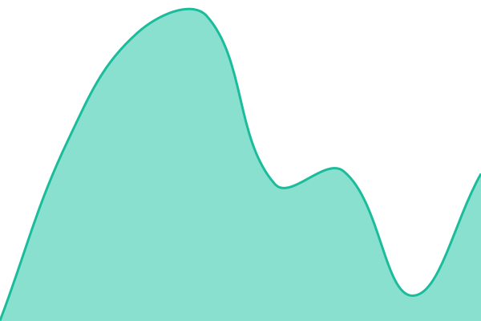
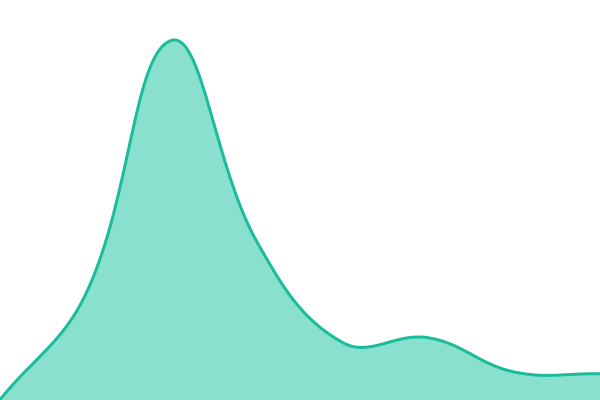
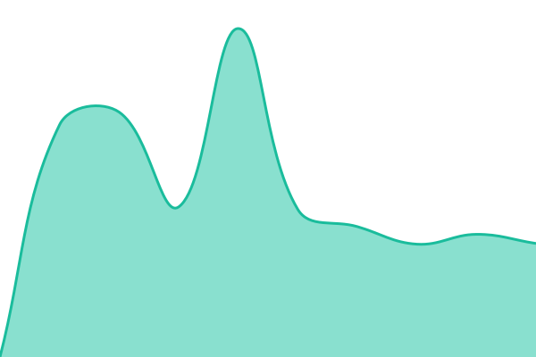
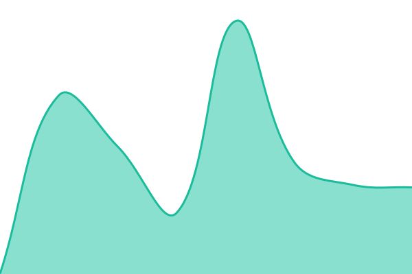

# [📈 Live Status](https://aron296.github.io/third-place-status): <!--live status--> **🟩 All systems operational**

This repository contains the open-source uptime monitor and status page for [aron296](https://aron296.github.io/third-place-status), powered by [Upptime](https://github.com/upptime/upptime).

With [Upptime](https://upptime.js.org), you can get your own unlimited and free uptime monitor and status page, powered entirely by a GitHub repository. We use [Issues](https://github.com/aron296/third-place-status/issues) as incident reports, [Actions](https://github.com/aron296/third-place-status/actions) as uptime monitors, and [Pages](https://aron296.github.io/third-place-status) for the status page.

<!--start: status pages-->
<!-- This summary is generated by Upptime (https://github.com/upptime/upptime) -->
<!-- Do not edit this manually, your changes will be overwritten -->
<!-- prettier-ignore -->
| URL | Status | History | Response Time | Uptime |
| --- | ------ | ------- | ------------- | ------ |
|  [Site (home)](https://society.thirdplacerotterdam.nl/) | Werkt | [site-home.yml](https://github.com/aron296/third-place-status/commits/HEAD/history/site-home.yml) | 

 444ms
     
 | 

<a href="https://aron296.github.io/third-place-status/history/site-home">100.00%</a>
    

|  [Zaalverhuur (/the-place)](https://society.thirdplacerotterdam.nl/the-place) | Werkt | [zaalverhuur-the-place.yml](https://github.com/aron296/third-place-status/commits/HEAD/history/zaalverhuur-the-place.yml) | 

 171ms
     
 | 

<a href="https://aron296.github.io/third-place-status/history/zaalverhuur-the-place">100.00%</a>
    

|  [Offertepagina](https://society.thirdplacerotterdam.nl/verhuur/betalen/proef) | Werkt | [offertepagina.yml](https://github.com/aron296/third-place-status/commits/HEAD/history/offertepagina.yml) | 

 146ms
     
 | 

<a href="https://aron296.github.io/third-place-status/history/offertepagina">100.00%</a>
    

|  [Betalingen (Stripe-webhook)](https://urhhdbjctoygohagdiqj.supabase.co/functions/v1/stripe-webhook) | Werkt | [betalingen-stripe-webhook.yml](https://github.com/aron296/third-place-status/commits/HEAD/history/betalingen-stripe-webhook.yml) | 

 930ms
     
 | 

<a href="https://aron296.github.io/third-place-status/history/betalingen-stripe-webhook">97.48%</a>
    

|  [Akkoord op offertes](https://urhhdbjctoygohagdiqj.supabase.co/functions/v1/verhuur-betalen) | Werkt | [akkoord-op-offertes.yml](https://github.com/aron296/third-place-status/commits/HEAD/history/akkoord-op-offertes.yml) | 

 351ms
     
 | 

<a href="https://aron296.github.io/third-place-status/history/akkoord-op-offertes">100.00%</a>
    

<!--end: status pages-->

[**Visit our status website →**](https://aron296.github.io/third-place-status)

## 📄 License

- Powered by: [Upptime](https://github.com/upptime/upptime)
- Code: [MIT](./LICENSE) © [Anand Chowdhary](https://anandchowdhary.com)
- Data in the `./history` directory: [Open Database License](https://opendatacommons.org/licenses/odbl/1-0/)
